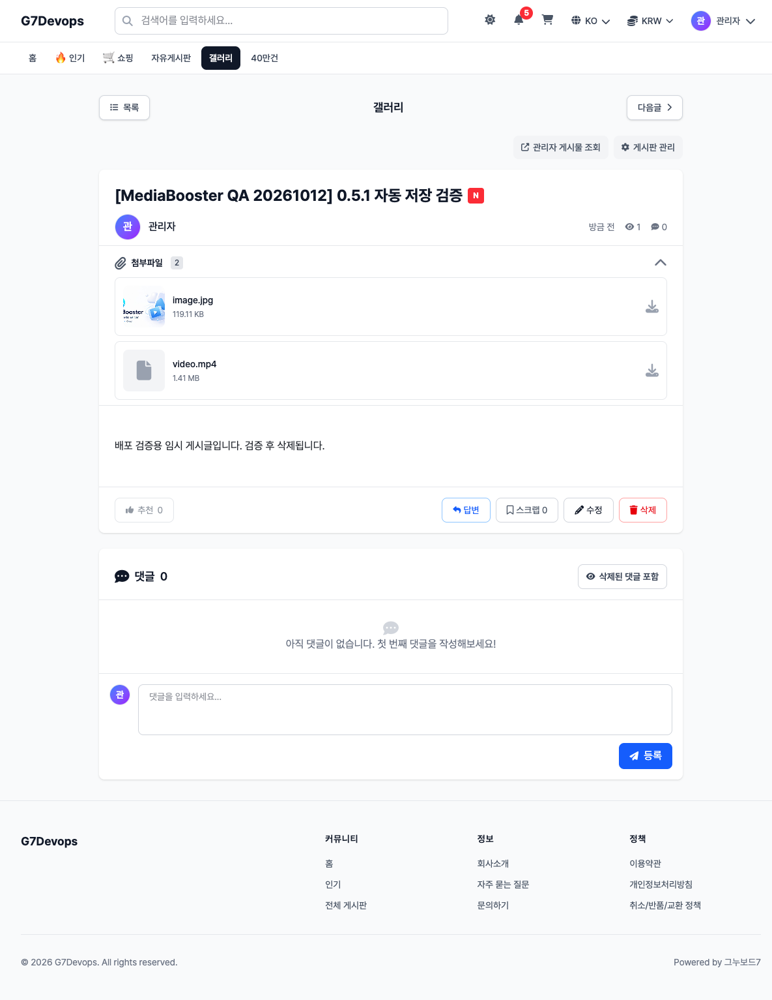
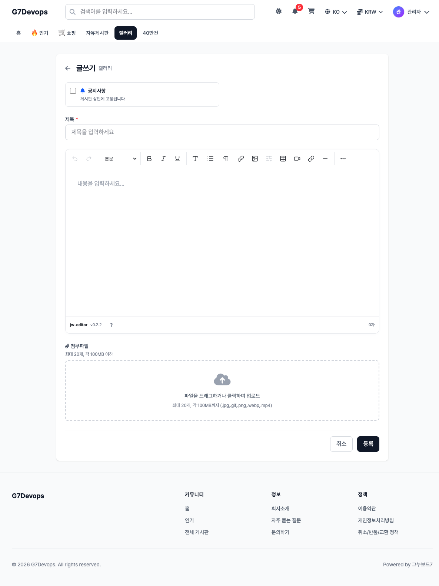
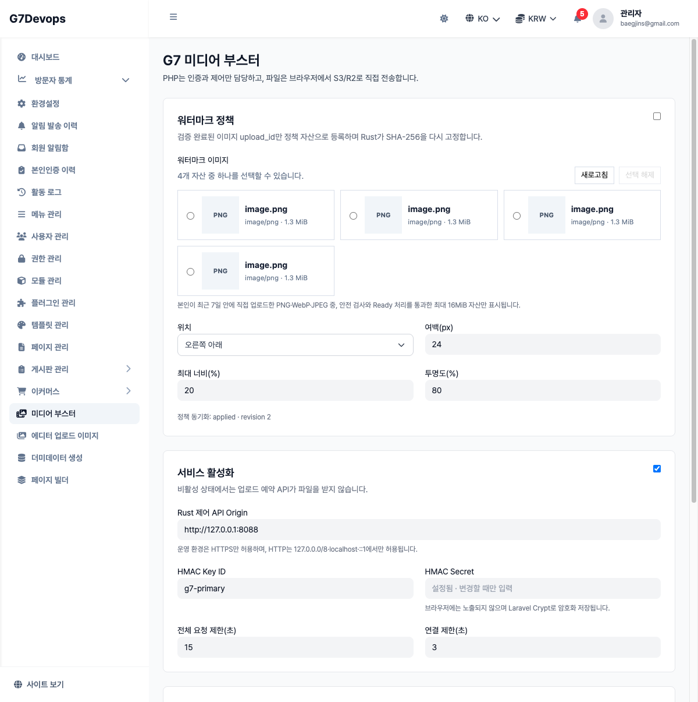
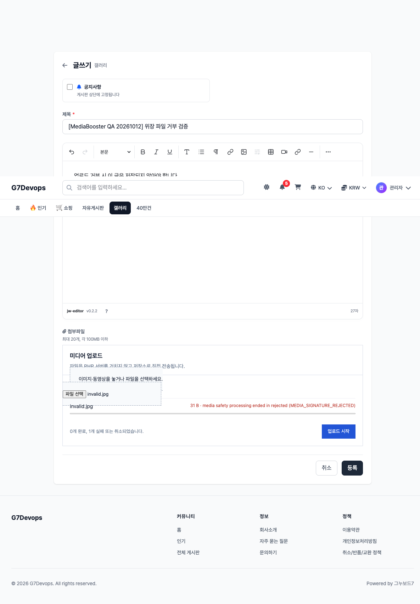

# g7devops.com core-free 어댑터 배포·R2 실검증

- 날짜: 2026-10-12
- 대상: `www.g7devops.com`, SSH 별칭 `g7devops`
- G7 7.1.0 / `sirsoft-board` 1.2.0 / PHP 8.5.9 / Laravel 12.69.3
- 사용자 템플릿 `jiwonpapa-devops`, 관리자 템플릿 `sirsoft-admin_basic`
- 모듈: 0.4.3 → **0.5.1**, adapter contract 1.0.0
- 기존 Rust 서버: 0.1.1 유지, libvips 8.15.1 / FFmpeg 6.1.1
- 설치 산출물 commit: `4f629f7222b91d1ad47e9660e1ea6e8dd943e4bd`
- ZIP: 132,431 bytes, SHA-256 `cba8e3ad7bb002fe21c467ab88be6085a45507bcfa902586884944f75bc1d922`

## 배포 및 원본 보존

운영 서버의 기존 수정 사항을 보존하고 G7 공식 `module:update`의 ZIP·`--layout-strategy=keep` 경로를
사용했습니다. 자체 모듈 외 코어·게시판·템플릿 원본을 직접 수정하거나 git으로 되돌리지 않았습니다.
관리자 설정과 R2 자격증명은 재입력·재발급하지 않았습니다.

| 검사 | 결과 |
|---|---|
| 배포 전후 native snapshot | 25,961개 파일, 추가/변경/삭제 **0개** |
| 서버 TOML + 자격증명 3개 해시 | 변경 **0개** |
| 기존 R2 접속 | `g7mbctl doctor` single object / multipart PASS |
| 모듈·target·loopback API | active / active / ready |
| 마지막 상태 | 신규 MediaBooster 업로드 활성화 |

비밀값은 출력·문서화하지 않았습니다. R2 키와 HMAC secret은 기존 0600 파일을 유지합니다.
공개 API 프록시나 nginx 설정은 변경하지 않았습니다. PHP 제어 요청은 `127.0.0.1:8088`,
실제 파일 바이트는 브라우저에서 R2로 직접 전송됩니다.

백업과 전후 검사 receipt는 서버의 root 전용 디렉터리
`/var/backups/g7mediabooster/g7mb-corefree-20261012T082115Z`에 보관합니다.
기존 모듈 0.4.3 ZIP·설정 복사본·native snapshot·credential hash가 포함됩니다.
이번 공식 ZIP **업데이트** 증거를 신규 stock 사이트 **첫 설치** 증거로 취급하지 않습니다.

## 실제 브라우저·저장소 검증

기존 관리자 계정의 짧은 수명 테스트 토큰으로 실제 사용자 게시판 폼을 실행했습니다.
사용자·역할·비밀번호는 생성하거나 변경하지 않았습니다.

| 시나리오 | 결과 |
|---|---|
| 이미지 + MP4 동시 선택 후 등록 한 번 | single PUT + multipart, 실제 R2 PUT 200, 두 파일 Ready |
| 원본 게시글 생성 | POST 201, `attachment_count=2`, native 첨부 2개 연결 |
| 이미지 미리보기 | native attachment URL, JPEG 1,280×512 실제 표시 |
| 영상 poster | native `/preview` 경로, JPEG 1,280×720 HTTP 200 |
| 텍스트를 JPG로 위장 | `MEDIA_SIGNATURE_REJECTED`, 게시글 저장 요청 0개 |
| 업로드 적용 해제 | 자체 uploader 제거, 원본 uploader 복원 |
| 해제 상태의 기존 첨부 | 이미지 표시 및 영상 poster 전달 유지 |
| 재적용 | 사용자·관리자 layout mount 및 ready 상태 복구 |
| 관리자 설정 화면 | 메뉴·enabled·HMAC 설정됨·policy applied revision 2 확인 |

영상 multipart는 약 1.4 MiB 파일의 단일 final part였습니다. 이 사례를 2-part·5 GiB·중단 재개
검증으로 확대 해석하지 않습니다. 실제 게시글 1850024 / 첨부 43·44로 검증했으며 이후 삭제했습니다.
기본 게시판의 영상 행은 파일 아이콘으로 표시됩니다. **poster 생성·전달 성공과 UI 자동 표시 지원은 구분합니다.**









## 실제 검증에서 수정한 회귀

1. 0.5.0 클라이언트가 과거 모듈 전용 URL만 허용해 native 첨부 URL을 거부했습니다.
   0.5.1은 같은 게시판·같은 hash의 다운로드/preview 경로만 허용하며 외부·다른 게시판·query는 거부합니다.
2. 업로드 실패 시 원본 저장 동작이 계속될 수 있어 이벤트 성공 조건을 기존 조건과 함께 보존·검사합니다.
3. 원본 응답 필드 `attachment_count`·`has_attachment`를 동기화합니다.
4. 제어 하네스가 실제 활성 사용자/관리자 템플릿을 조회하도록 수정했습니다.
   의도적으로 해제된 uploader 부재를 layout 오류로 보고하지 않습니다.
5. 개발 의존성 advisories를 lock 갱신으로 해소했습니다. 전체/production npm audit 모두 0건입니다.

0.5.0에서 실패한 첫 게시글을 0.5.1의 정상 생성 증거로 재사용하지 않았습니다.
수정 후 새로운 폼에서 이미지·영상 선택부터 등록·표시까지 다시 검증했습니다.

## 자동 검증 및 정리

- 0.5.1 PHP unit: 61 tests / 154 assertions PASS
- TypeScript: 28 tests / 5 files, typecheck 및 production build PASS
- Python: 38 tests PASS, release-policy / feature-status PASS
- 서버 설치 모듈의 공개 capability verifier PASS
- 이전 독립 stock 7.1 host 회귀: 17 tests / 59 assertions PASS
  ([초기 구현 기록](G7_CORE_FREE_710_20261012.md); 0.5.1 전체 host suite 재실행 증거는 아님)
- 테스트 upload 9개 모두 `deleted`, 테스트 게시글 2개·첨부 8개·자체 세션 정리 완료
- 해당 테스트 토큰 잔여 0개, 사용자 콘텐츠·기존 자격증명 보존
- Rust 코드 미변경: 이 배포에서 전체 Rust 재빌드·전체 CI는 수행하지 않음

## 즉시 적용·해제

저장소 루트에서 실행합니다. 실제 서버에서 두 방향 모두 검증했습니다.

```bash
scripts/g7-live-control.sh status
scripts/g7-live-control.sh disable --confirm g7devops
scripts/g7-live-control.sh apply --confirm g7devops
```

관리자 메뉴 **미디어 부스터 → 업로드 사용**에서도 해제할 수 있습니다.
화면 주소는 `https://www.g7devops.com/admin/media-booster/settings`입니다.
해제는 신규 업로드만 원복하며 기존 원격 첨부 열람에 필요한 모듈·API는 유지합니다.
이번 수동 배포 백업 receipt는 자동 설치기의 rollback receipt와 형식이 다릅니다.
`rollback --deployment-id`로 이 백업을 복원할 수 있다고 안내하지 않습니다.
이전 버전 복원은 보관 ZIP과 공식 G7 업데이트 절차를 별도로 검증한 뒤 수행해야 합니다.

## 남은 배포 경계

이 서버의 승인된 canary 배포는 완료했지만 `gnuboard7_module`은 `IMPLEMENTED`,
`publishable=false`를 유지합니다. 다음을 모든 사용자에 대한 정식 지원으로 게시하지 않습니다.

- 새 stock 사이트 첫 ZIP 설치·활성화·설정 입력·업데이트·제거 전체 수명주기
- 일반 회원/타인/비로그인/비밀/블라인드의 실제 HTTP 권한 매트릭스
- 관리자 게시글 폼의 실제 생성·수정 전체 브라우저 종단
- 대량 batch·실 R2 5 GiB·중단 재개·보존 기간 만료에 의한 실제 삭제
- 영상 poster의 목록/본문 자동 표시 및 다른 커스텀 템플릿
- AWS S3·Lightsail 실계정 conformance

과거 patched 호스트 증거와 이번 core-free 증거를 구분합니다.
